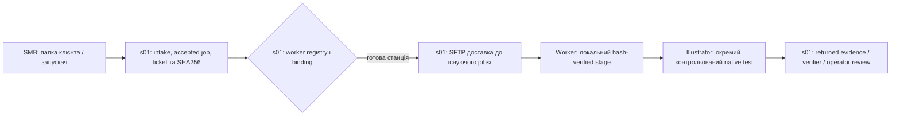
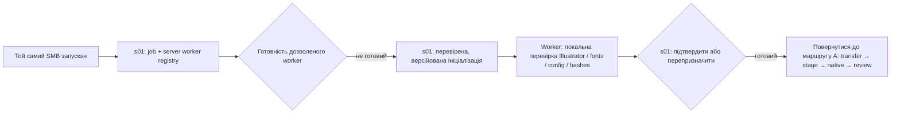

# GDL · Execution Chain: сервер → клієнтський SMB-вхід → змінний Worker

**Статус:** `OWNER_ARCHITECTURE_DECISION / DOCUMENTED_REFERENCE`, 27.10.2026. **Не є:** дозволом на виробництво, автоматичним запуском Illustrator або твердженням, що багатовузлова оркестрація вже працює.

**Єдине структуроване джерело для HTML:** `coordination/graphic_design_lab/template_studio/gc32_infrastructure_map_v0_1.json` → `execution_model` (`forprint_gdl_client_entry_worker_lifecycle_v0_1`). Цей Markdown — пояснювальний людський документ. HTML вкладки **«Конвеєр і контроль»** відображає ті самі поля, не звертаючись до файлової системи чи мережі.

## 1. Рішення власника: ієрархія правди та початок виконання

| Складова | Сутність | Що **не** дозволено |
|---|---|---|
| `s01 / ForPrint_Graphic_Design_Lab` | **Канонічне джерело** коду, бібліотеки, шаблонів, контрактів, політик, версій, призначення робочих вузлів та приймання evidence | Не переносити ownership/Git/authority на Windows |
| `<папка клієнта>/_forprint_automation` у серверній SMB-шарі | **Постійний операційний старт** для замовлення: запускач, прийняті вхідні матеріали, статус, перегляд, історія запусків | Не створювати з цього каталогу новий master-repo проєктного коду |
| Server-owned Dispatcher / Make/CLI | Перевірити intake/job → contract → ticket → SHA256 → дозволеного виконавця → transport/stage → evidence | Не обирати довільно непогоджену машину, не надавати acceptance |
| Призначений Windows Worker | **Відновлюваний виконавець**: встановлюється/завантажується під конкретний job, має локальний SHA256-кеш; може змінюватися від замовлення до замовлення | Немає першоджерела, немає production authority; не покладатися на один PREPRESS як незамінний вузол |
| Серверний verifier + оператор | Порівняти фактичні AI/PDF/PNG/JSON, reopen, fonts/layers та художній результат; прийняти чи повернути на rework | Не приймати `RC=0`, self-report або `STAGED` за готовий макет |

Папка клієнта **головна як операторська точка входу**, але **серверний проєкт — головний як джерело істини**. Ці ролі різні й не суперечать одна одній.

Історичний GC30 launcher присутній у SMB: `Створити_листівку.cmd` → `gc30_submit_only_v0_1.ps1`; `gc30-client-check` показував `CURRENT`. Це підтверджує наявність стартового вузла, **але не доводить** автоматичний chain A або B.

## 2. Два шляхи від одного стартового каталогу

### A. Підготовлений виконавець (поточний обмежений пілот)

**Доведено станом на 27.10.2026:** один прийнятий DEG job, один server-created ticket, обмежене призначення `PREPRESS/Work`, SFTP payload SHA256, staging у `D:\ForPrint_Automation\GraficsDesignLab\Automation\jobs\<ticket>\stage` — 16 файлів, 12 assets. Підтверджено встановлення Illustrator 2026 і відсутність `stage/out` під час перевірки. `GC30_NATIVE_OUT=ABSENT`. **Native test ще не виконано**, результатів AI/PDF/PNG/JSON немає. Завершені r002A/B/C — не доказ автоматичної роботи launcher до кінця ланцюжка.

### B. Відсутнє або непридатне робоче середовище (затверджений напрям розвитку, ще не runtime)

**Заплановано реалізувати:** launcher відправляє intent на s01, сервер читає власний реєстр станцій та їхні можливості, перевіряє readiness, доставляє лише дозволену версію bootstrap у погоджений локальний корінь, звіряє встановлення, після чого продовжує **той самий** ticket шляхом A. Якщо вузол не готовий — явне блокування або reassignment із повним слідом рішення. Windows не «сам собі інсталятор» і не має можливості оновлювати master-логіку чи самостійно видати approval.

## 3. Каталоги та транспорт

- **На s01**: проєкт `ForPrint_Graphic_Design_Lab` із Git, Make/CLI, версійними контекстами й тестами. Код, registry призначень та приймання належать s01.
- **Клієнтське SMB**: `<клієнт>/_forprint_automation` — джерело прийнятого замовлення, старт і статуси. Поточні `input/`, `output/`, `template_studio/`, `worker_bootstrap/` — функціональні гілки операційного workspace, не місце основного коду.
- **Локальна станція**: один `D:\ForPrint_Automation\GraficsDesignLab\Automation`; існуючі `Worker/`, `cache/`, `config/`, `jobs/`, `logs/`, `runtime/`. GC32 та `config/worker_config.json` не чіпати, без нових паралельних `%LOCALAPPDATA%/ForPrint/Automation`, `Clients/` або `Shared/`.
- **Транспорт r002:** сервер бачить SMB; Windows OpenSSH-сеанс `Work` отримував `UnauthorizedAccessException` до SMB. Затверджений пілотний обхід *не змінює ACL*: s01 валідує замовлення, доставляє рівно один checksum-pinned payload через SFTP до `jobs/<ticket>` і перевіряє hash на Windows. Повернення результату відокремлено та ще має бути реалізоване.

## 4. Явна межа «зроблено» проти «потрібно зробити»

| Здатність | Статус |
|---|---|
| Вхідний cmd/bootstrap у SMB папці клієнта | Файли `CURRENT`, але наскрізний orchestration не доведений |
| Accepted job → SHA-pinned ticket | `EVIDENCED_PILOT` |
| Машина `PREPRESS/Work` | Один binding `VERIFIED`; general multi-worker routing не готовий |
| s01 → PREPRESS SFTP transfer | `PASS_NON_AUTHORIZING`, один ticket |
| Локальний stage | `PASS_NON_AUTHORIZING`, 16 файлів/12 ресурсів |
| Native Illustrator output | `NOT_EXECUTED`, `out` відсутній під час останньої перевірки |
| Return verification / operator acceptance | `PLANNED_NOT_ATTESTED` |
| Самоініціалізація на іншій станції | `PLANNED_NOT_IMPLEMENTED` |
| Динамічний pool workers і reassignment | `PLANNED_NOT_IMPLEMENTED` |

## 5. Умови подальшої реалізації (без передчасного дозволу)

1. Створити server-owned реєстр машин/можливостей та прив'язку `ticket → allowed worker`, з ідентичністю, readiness і доказовою відмовою.
2. Перевести клієнтський launcher на **intent** до проєктного Make/CLI, з явним status readback. Launcher не зберігає business-логіку, не читає довільний Git і не запускає самовільний deploy.
3. Запровадити контрольований `ensure-worker-ready`: перевірка існуючої D:-структури, bootstrap через дозволений transport, SHA/версія, fonts/Illustrator, без overwrite невідомих файлів.
4. Продовжувати шлях A без нового ticket і без паралельного виконання: deliver/check → stage/check → explicit native boundary → return/check → operator review.
5. Верифікувати незалежно output AI, reopen, текстові шари, clipping, шрифти, PDF/PNG, відповідність P01–P04; тільки людина може авторизувати подальшу публікацію.
6. Після кожного етапу зберігати evidence і completion у server-owned ledger; відхилені/неповні спроби не стираються й не приймаються автоматично.

## 6. Інструкція для наступної помічниці

1. Починай з `gc32_infrastructure_map_v0_1.json` → `execution_model` і HTML вкладки «Конвеєр і контроль»; не приймай старий текст про `GC32 PollOnce` за підтверджений GC30 execution.
2. Не міняй `GC32`, `config/worker_config.json`, локальні каталоги PREPRESS або існуючий ticket без окремого operator review.
3. Якщо `out` порожній, це не означає, що слід повторити staging або створити новий ticket: спочатку перевір поточний стан і evidence.
4. Нові capability/transport/worker lifecycle кроки здійснюй server-native Make/CLI, не великою ручною серією SSH-команд.
5. Відрізняй контрактні маршрути A/B від фактичного runtime за machine-verifiable evidence. HTML — тільки read-only паспорт архітектури.

**Governance:** `NON_AUTHORIZING` · `NO_AUTO_DISPATCH` · `NO_AUTO_BOOTSTRAP` · `NO_AUTO_ILLUSTRATOR` · `NO_AUTO_PRINT` · `NO_AUTO_PUBLISH`.
