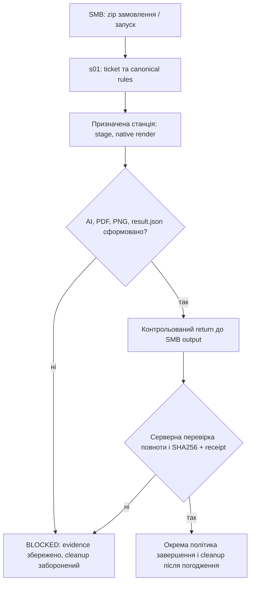

# ForPrint GDL · Паспорт погоджень листівки та життєвого циклу output (v0.1)

**Статус:** `OWNER_FEEDBACK_IN_PROGRESS / NOT_CANONICAL_FOR_RUNTIME`, 28.10.2026. Цей текст фіксує висловлені наміри і спостереження, а не автоматичний дозвіл змінювати Illustrator, видаляти Windows-файли або затверджувати макет. **Машинне джерело для HTML:** `gc32_infrastructure_map_v0_1.json` → `approval_register`. Надалі це має опрацьовуватися через проєктний Make/CLI з незалежною перевіркою evidence. У Template Studio — вкладка **«Питання на погодження»**, групування за тематикою, локальна чернетка відповідей (JSON), без запису на SMB і без зв'язку з runtime.

## 1. Робочий цикл погодження одного блоку

1. **Observed:** технічний факт, код помилки, SHA256, скриншот і номер блоку `P01`–`P04` / `OUTPUT` / `WORKER`.
2. **Operator expected:** власник описує потрібну поведінку, позицію і критерії, за необхідності прикріплює візуальний приклад.
3. **Approved rule:** лише після явного погодження записується структуроване нормативне правило в канонічний паспорт блока, з версією та доказом рішення.
4. **Implementation / acceptance:** окремий patch у server-owned GDL, тест і фактичний Illustrator-proof; візуальний review відокремлений від `RC=0`.

Поки поле `approved_rule` не погоджено, жодні вигадані пороги на кшталт «20 рядків» не слід вважати правилом клієнта.

## 2. Перший фактичний native-пілот DEG

- Ticket: `gdl_gc_deg_20261011__34b9b61741d5ca`.
- Джерело JSX SHA256: `438f407b8fbb9913fc3dae21dd71f35585a78a5de146062f42d682b3f12710c1`.
- Видимий у наданому скриншоті: **чотири артборди** та редаговані на вигляд об'єкти в панелі Illustrator. Позначка документа: `Untitled-1*`, тобто збереження не підтверджене.
- На PREPRESS отримано тільки `stage/out/result.json` (SHA256 `7720b9fca4b788f04315529178aec99c623b6621bdaf5a2cc3d91a856325ae49`), статус `BLOCKED_REVIEW_REQUIRED`, код `GC29_GREETING_OVERFLOW_REVIEW_REQUIRED`, `pages=4`, `production_ready=false`. Немає підтверджених `design.ai`/`review.pdf`/PNG.
- P04 у сценарії: 898 символів, 9 початкових абзаців, найбільший абзац 337 символів; фактична кількість рядків після layout **не зафіксована**.
- Візуальна присутність тексту на скриншоті не доводить, що він повністю міститься в area type або що немає overflow. Визначити реальний Illustrator-layout і геометрію перед будь-яким fit patch.
- `flower_photo.png` — наданий растр троянд. `compound_path(2).pdf` — односторінковий PDF з векторним контуром декоративної рамки. Їхні точні семантичні ролі у clipping — **питання до погодження**, не припущення.

## 3. Пропонований життєвий цикл, поки НЕ дозвіл на очищення

**Рішення власника як напрям розвитку:** після завершення листівка повністю повертається до `<client>/_forprint_automation/output/`, а тимчасові дані Worker можуть видалятися, щоб не накопичуватися. **Реалізацію автоочищення не дозволено**, доки не прийнято обсяг результату, відмовостійкість, перевірку передачі та правило поводження з невдалими спробами. Робоча станція — не authority, не джерело історії та не власник даних.

**Майбутня опція:** `KEEP_FOR_REWORK` на окрему вимогу, з TTL/обсягом/передаванням іншому Worker; не змішувати з поточним правилом.

## 4. Компактна назва результату, без журналу на Worker

**Робоча пропозиція, не затверджена:** назва папки = операторська коротка назва вихідного ZIP (`stem`, бажано до 16 символів) + `_YYMMDD-HHMMSS` за годинником `Europe/Kyiv`. Наприклад, `DEG_261028-104512` (17 символів). У machine receipt окремо зберігається повна назва ZIP, UTC timestamp/offset, ticket ID, SHA256 і цільовий output. **Чотирьох останніх цифр часу недостатньо для захисту від колізій.**

Якщо та сама назва зайнята, виключно s01 при створенні в клієнтському SMB `output/` атомарно резервує назву з `-02`, `-03` тощо. Не перезаписувати попередній результат, не визначати наступний номер на Windows, не довіряти локальній історії після очищення. Відсутність окремого журналу назв не означає відсутність мінімального приймального receipt.

Не виконувати автоматичне створення директорій за цією схемою, поки ім'я та контракт публікації не погоджено.

## 5. Реєстр питань і наступна помічниця

Дивись `approval_register.groups[].questions[]` у карті інфраструктури. Основні теми:

- Збереження/закриття AI, return на SMB, cleanup і майбутнє збереження для правок.
- Назва за вхідним ZIP, захист від колізій, необов'язковий журнал у майбутньому.
- P04: довгий текст, реальний bounds/overflow, шрифт, міжряддя та підпис.
- P03: фотографія, кадрування і роль `compound_path` у clipping.
- Діагностика, версії сценарію й критерії погодження кожного з 20 паспортних елементів.

Порядок роботи: зібрати операторські відповіді; звірити з існуючими canonical паспортами; окремо затвердити правила; лише тоді розробляти patch і acceptance tests. **Не перезапускати вже заблокований ticket; не видаляти `result.json`; не патчити його JSX у place.**

**Межі:** `NO_AUTO_APPROVAL`, `NO_AUTO_OUTPUT_PUBLISH`, `NO_AUTO_CLEANUP`, `NO_AUTO_NATIVE_RETRY`, `NO_CLIENT_TEXT_IN_TECHNICAL_LOGS`.

## 6. P04 — погоджені пілотні правила й звірка з Prepress Hub (28.10.2026)

**Статус:** `OWNER_RULES_PILOT_CONFIRMED / GC29_SOURCE_PORT_NOT_IMPLEMENTED`. Цей розділ уточнює `GC-REV-008` і `GC-REV-009`, але не надає права на запуск Worker,
 автоматичну публікацію результату чи очищення. Повний машинний аудит:
 `coordination/graphic_design_lab/greeting_cards/gdl_gc_p04_prepress_source_reconciliation_v0_1.json`.

### 6.1. Рішення власника для першого пілота

- Увесь текст привітання має залишатися без скорочення, переписування або втрати символів.
- Зона P04 зафіксована: фізичні PDF-координати `[32,32,182,212]` мм,
  **150 × 180 мм**; вона не збільшується.
- В межах зони дозволена автоматична адаптація **кегля й міжряддя**, а візуальна
  основа P04 цього пілота визнана прийнятною для продовження.
- Не блокувати весь пілот лише через довільний поріг рядків. Якщо графічний
  результат можна сформувати для огляду, зберегти AI/PDF/PNG і технічні попередження;
  **справжні технічні помилки та втрату тексту не маркувати успіхом**.
- Підписант і графічний підпис — два різні типи об'єктів. Координати й розміри
  брати з перевірених варіантних джерел Prepress Hub, не визначати зі скриншота.

### 6.2. Що фактично підтверджено в Prepress Hub

- Знімок `b26cce19f4700cadaf34323e4c2e2909bcf5fcd8` має 11 файлів,
  усі їхні SHA256 звірено в переданому аудиті.
- Актуальний renderer (`app/.../greeting_card_builder_renderer.py`) використовує
  `_fit_greeting()` із послідовністю **7 мм (19,8425 pt), 18,5, 17, 16,5, 16 pt**;
  у пробному PyMuPDF textbox перевіряє фактичне вміщення, відступ знизу на
  дві візуальні лінії та вертикальне центрування.
- Фіксовані координати профілю `page4_canonical_repair_profile_v0_1.yaml`:
  GRIGO: sender start `y=222.0` мм; HERASYMENKO: `y=224.5` мм;
  текстові межі `x=[31,101]` мм; HERASYMENKO graphic signature
  `bbox=[82.877,214.875,128.258,274.141]` мм (усе в physical PDF).
- Watermark P04: `opacity=0.25`, геометрія — точна з канонічного джерела.
  DUAL збережений як candidate, але runtime вимкнено.
- Реальний renderer уже відрізняється від старого
  `deterministic_builder_v0_1.yaml` (набір шрифтових tiers), тому не можна
  повертатися до ранньої константи як до чинної.

### 6.3. Що ще не доведено

- `GC29` native JSX, за знімком r009, використовує кегль 7 мм і міжряддя 8 мм,
  поріг `t.lines.length * 8 мм < 164 мм`, та фіксовані baselines
  `[227,235,243,251]` замість варіантного профілю підписантів.
  Це **source-level gap**, не виправлене виконання.
- В архіві немає кодів `source_sender_rows`, `sender_zone_planner_v0_1`,
  `sender_typography_v0_1` і `canonical_sender_blocks_v0_1.yaml`.
  Остаточне редаговане native відтворення всіх підписів ще не атестовано.
- Стандартизований мінімально допустимий кегль у власника не погоджений.
  16 pt — технічна межа історичного bounded review, не нове рішення власника.
- Поточний `result.json` DEG: `GC29_GREETING_OVERFLOW_REVIEW_REQUIRED`;
  збереженого native AI, PDF і PNG ще не підтверджено.

### 6.4. Наступна робота

Окремий GC29 patch повинен: зберегти перевірені P04 geometry/variant bindings,
 адаптувати native fit і leading, прибрати довільний 20-row stop,
 записувати diagnostics без приватного тексту, зберігати й закривати AI,
 створювати нову *attempt* без перезапису старого ticket `stage/out`, після чого
 виконати візуальний review. Спочатку доповнити source audit відсутніми
 planner/profile dependencies. Поточний документ **не дозволяє** змінювати
 Prepress Hub, запускати Illustrator, автоматично видаляти локальні файли
 або виконувати production publication.
